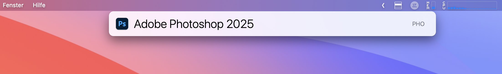

# Get Recent Adobe Documents for LaunchBar

This repository provides a suite of LaunchBar [actions](https://www.obdev.at/products/launchbar/actions.html) for accessing recent Adobe documents. The actions are designed to streamline access to recent files for users working with Adobe [Acrobat](https://www.adobe.com/acrobat.html), [Photoshop](https://www.adobe.com/products/photoshop.html), and [Illustrator](https://www.adobe.com/products/illustrator.html).



## Contents

This repository includes the following components:

- **Actions**: Pre-packaged LaunchBar actions in `Actions.zip`, attached to each [release](https://github.com/alberti42/Get-Recent-Adobe-Documents-For-LaunchBar/releases), to enable direct access to recent documents. The bundles without the compiled tools are in `Actions/`.
- **Source Code**:
  - **BDAlias**: Helper library for managing macOS aliases.
  - **GetRecentAcrobatDocuments**: Retrieves recent Adobe Acrobat documents.
  - **GetRecentIllustratorDocuments**: Retrieves recent Adobe Illustrator documents.
  - **GetRecentPhotoshopDocuments**: Retrieves recent Adobe Photoshop documents.
  - **GetRecentAdobeDocumentsLib**: Shared library used across Adobe document retrieval actions.

## Installation

### Option 1: Manual Installation

1. **Download** the pre-packaged actions from the [Actions.zip](https://github.com/alberti42/Get-Recent-Adobe-Documents-For-LaunchBar/releases/latest/download/Actions.zip) of the latest release.
2. **Extract** the contents, which include:
   - `Recent Acrobat Documents.lbaction`
   - `Recent Illustrator Documents.lbaction`
   - `Recent Photoshop Documents.lbaction`
3. Place these `.lbaction` files into your LaunchBar Actions folder:
   ```
   ~/Library/Application Support/LaunchBar/Actions
   ```

4. **Restart LaunchBar** to load the new actions.

### Option 2: Automatic Installation

Alternatively, you can simply double-click each `.lbaction` file. This will automatically install the action in LaunchBar.

## Compilation Instructions

Compilation from the source code is not necessary if you simply plan to use the actions. The tools in the released `Actions.zip` are signed with a Developer ID and notarized by Apple. Requirements: macOS 12 or later and Xcode.

1. **Build** the three actions:
   ```
   bin/build_actions.sh
   ```
   The script builds `GetRecentAcrobatDocuments`, `GetRecentIllustratorDocuments` and `GetRecentPhotoshopDocuments` for arm64 and x86_64, puts each tool into its bundle from `Actions/`, signs it, and packs the bundles into `build/Actions.zip`. Without an argument it signs ad hoc, which is enough to run the actions on your own Mac. To sign with a Developer ID, give the identity as argument:
   ```
   bin/build_actions.sh "Developer ID Application: Your Name (TEAMID)"
   ```
   macOS kills an arm64 executable that carries no signature, so every tool must be signed.

2. **Install** the built actions by double-clicking each bundle in `build/Actions/`, or copy them to:
   ```
   ~/Library/Application Support/LaunchBar/Actions
   ```

To work on the code in Xcode, open the workspace `GetRecentAdobeDocuments.xcworkspace` and select one of the schemes `GetRecentAcrobatDocuments`, `GetRecentIllustratorDocuments` or `GetRecentPhotoshopDocuments`.

## Releasing

`CHANGELOG.md` is based on [Keep a Changelog 1.1.0](https://keepachangelog.com/en/1.1.0/), and this project adheres to [Semantic Versioning 2.0.0](https://semver.org/spec/v2.0.0.html). Pre-releases carry a `-beta.N` suffix (`vX.Y.Z-beta.N`).

1. Describe the changes under `## [Unreleased]` in `CHANGELOG.md` (Keep a Changelog 1.1.0).
2. `bin/bump_version.sh vX.Y.Z` (or `vX.Y.Z-beta.N`): sets `CFBundleVersion` in the three `Actions/*.lbaction/Contents/Info.plist`, moves the `[Unreleased]` entries under the version with `bin/changelog.py` (releases only), commits and tags.
3. `git push origin main --tags`. The tag starts `.github/workflows/draft-release.yml`: build with the Developer ID, notarize `Actions.zip` with `notarytool`, attest its build provenance, and create a draft release with `Actions.zip`. The release notes are the version's `CHANGELOG.md` section and a link to the commits since the previous tag. The workflow fails if the tag does not match `CFBundleVersion`.
4. Publish the draft on GitHub. `.github/workflows/verify-release.yml` then checks the published `Actions.zip` (provenance, signature, team, notarization); it also runs weekly.

To verify a downloaded `Actions.zip`:
```
gh attestation verify Actions.zip --repo alberti42/Get-Recent-Adobe-Documents-For-LaunchBar
```

## Usage

- Activate LaunchBar and type the name of the desired Adobe application.
- Press space to display directly from LaunchBar the recent documents of the selected Adobe application.

## Security

To report a vulnerability, see [SECURITY.md](SECURITY.md).

## Donations

If you find this plugin helpful, consider supporting its development with a donation.

[](https://buymeacoffee.com/alberti)

## Author

- **Author:** Andrea Alberti
- **GitHub Profile:** [alberti42](https://github.com/alberti42)
- **Donations:** [](https://buymeacoffee.com/alberti)

Feel free to contribute to the development of this plugin or report any issues in the [GitHub repository](https://github.com/alberti42/obsidian-plugins-annotations/issues).
